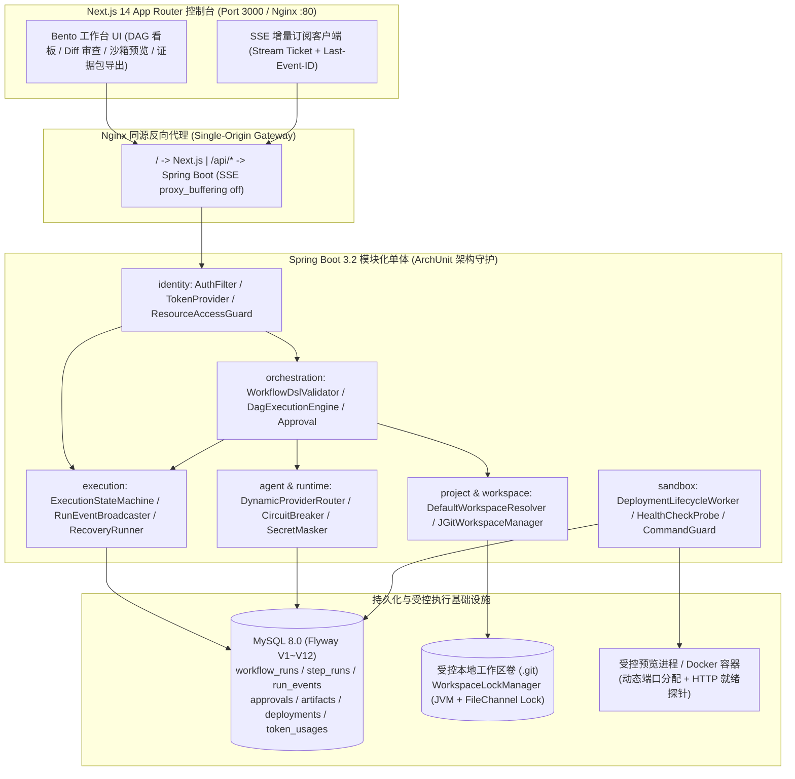
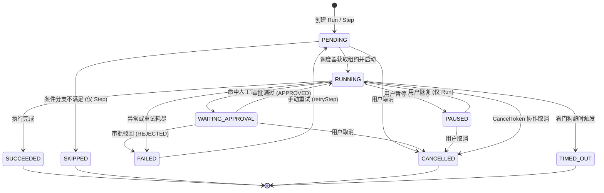
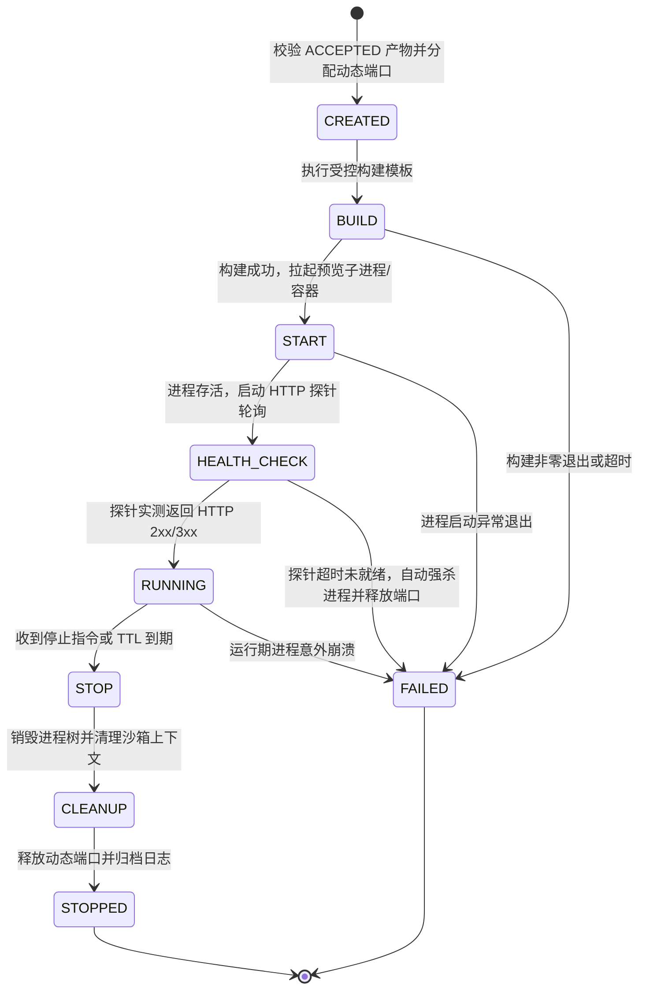

# AgentHub — 有状态多 Agent 协同研发编排与代码交付工作台

[](./agenthub-backend)
[](./agenthub-frontend)
[](./docs/adr/ADR-001-modular-monolith-architecture.md)
[](./docs/evidence/sample-run-evidence-bundle.json)

**AgentHub** 是一个面向软件研发场景的有状态多 Agent 协同编排、JGit 代码工作区管理与受控预览沙箱交付平台。系统基于 **Java 17 + Spring Boot 3.2 + MySQL 8.0 + JGit + Next.js 14** 构建，将多智能体协作从单次对话演进为**有状态 DAG 拓扑调度、数据库租约崩溃恢复、持久化增量 SSE 事件流、JGit 树级结构化 Diff 审查、人工审批门禁（Human-in-the-Loop）与可校验脱敏运行证据包（Sanitized Run Evidence Bundle）**的完整工程闭环。

---

## 一、 核心能力全景与模式边界（Demo Mode vs Live Provider Mode）

为兼顾**零外部 API Key 的离线快速评审/CI 回归**与**接入真实大模型 API 的在线生成**，系统在运行时、前端导航栏与导出证据包中严格区分两种执行模式：

| 对比维度 | 离线确定性演示模式 (`Demo Mode`) | 真实 Provider 驱动模式 (`Live Provider Mode`) |
| :--- | :--- | :--- |
| **设计目的** | 免外部 API Key 即可验证完整 DAG 状态机、审批阻塞、JGit Diff、预览沙箱与证据包导出 | 接入真实 DeepSeek / OpenAI / Anthropic / Gemini / Ollama 执行代码生成、熔断降级与 Token 记账 |
| **执行运行时** | `MockAgentRuntime` (`simulated = true`) | `ProviderDrivenAgentRuntime` (`simulated = false`) |
| **前端模式标识** | 顶部状态栏显式展示琥珀色 **`离线演示/模拟模式`** 徽章 | 顶部状态栏展示翠绿色 **`真实产品模式`** 徽章，严禁静默回退到 Mock 数据 |
| **Token 计费审计** | 仅产生模拟进度事件，不计入外部真实账单 | 经 `DynamicProviderRouter` 路由并在 `token_usages` 表落库真实 Token 消耗、实测延迟与成本 |
| **运行证据包字段** | `"simulated": true`, `"executionMode": "DEMO_SIMULATED"` | `"simulated": false`, `"executionMode": "LIVE_PROVIDER"` |

### 六大核心工程模块（Phase A ~ Phase F 已验收）

1. **认证鉴权与多租户资源归属防护 (`identity`)**：
   - 基于 `PBKDF2WithHmacSHA256` 密码哈希与 `HMAC-SHA256` 签名令牌，支持 `HttpOnly` Cookie 与 `Bearer` 双模鉴权；
   - 提供单次有效、60 秒过期的 SSE 流式订阅票据（`POST /api/auth/stream-ticket`），避免在 URL 查询参数中暴露长期令牌；
   - 由 `ResourceAccessGuard` 在 Project、Workspace、WorkflowRun、Approval、Deployment、Provider 入口统一强制校验 `owner_id` 归属权。
2. **多模型动态路由、熔断降级与凭据脱敏 (`agent` & `runtime`)**：
   - 统一抽象 `LlmProvider` SPI，内置 OpenAI、Anthropic、Gemini、DeepSeek 与 Ollama 适配器；
   - `DynamicProviderRouter` 支持按优先级、权重、能力标签（`code`/`reasoning`/`general`）与单价动态选路，结合滑动窗口 `CircuitBreaker`（`CLOSED -> OPEN -> HALF_OPEN`）自动故障转移；
   - `SecretMasker` 对日志、异常栈、URL 参数、环境变量赋值与证据包全文执行正则脱敏。
3. **有状态 DAG 编排、数据库租约与崩溃恢复 (`orchestration` & `execution`)**：
   - 基于 Kahn 算法执行 DAG 拓扑排序与环路检测，使用无反射 `SafeExpressionEvaluator` 解析条件分支与变量模板；
   - 在 `workflow_runs` 与 `step_runs` 表持久化 `dsl_snapshot`、`inputs_json`、`outputs_json`、`lease_owner`、`lease_until` 与 `heartbeat_at`；
   - `PersistentExecutionRecoveryRunner` 在进程重启后自动接管过期租约，**跳过已 `SUCCEEDED` 节点**并恢复 `WAITING_APPROVAL` 审批门禁；
   - `RunEventBroadcaster` 遵循 **先落库后推流（Persist-Before-Emit）**，支持 SSE `Last-Event-ID` 断点增量回放。
4. **服务端受控 JGit 工作区与结构化 Diff (`project` & `domain.workspace` & `audit`)**：
   - `DefaultWorkspaceResolver` 根据服务端 `workspaceId` 解析物理目录，严格拦截 `../` 目录穿越、绝对路径注入、敏感隐藏目录与符号链接逃逸；
   - `JGitWorkspaceManager` 在 Run 启动时建立基线 Commit，支持快照提交、Tree-to-Tree 结构化 `StructuredDiff` 计算以及单文件/整包 Revert 回滚。
5. **受控预览沙箱与真实 HTTP 探针生命周期 (`sandbox`)**：
   - 部署请求强制绑定已验收产物（`ACCEPTED` Artifact）与受控构建模板（`STATIC_WEB_TEMPLATE` / `SPRING_BOOT_JAR_TEMPLATE` / `NODE_WEB_TEMPLATE`），由 `CommandSecurityGuard` 拦截命令注入，由 `EnvironmentSanitizer` 剥离后端敏感环境变量；
   - `DeploymentLifecycleWorker` 与 `HealthCheckProbeService` 驱动 8 态部署生命周期，仅在实测收到预览端口 HTTP `2xx/3xx` 响应后才流转至 `RUNNING`。
6. **脱敏运行证据包（Sanitized Run Evidence Bundle）**：
   - 支持通过 API（`GET /api/executions/runs/{runId}/evidence`）或前端顶部 **`导出证据包`** 按钮一键导出包含 DSL 快照、Run/Step 状态、单调事件流、Provider/Runtime 审计、`simulated` 标识、JGit 结构化 Diff、测试验证摘要、审批记录、部署健康轨迹及确定性 **SHA-256 `checksum`** 的完整 JSON 证据包。

---

## 二、 系统架构与核心状态机拓扑

### 2.1 模块化单体架构图 (Modular Monolith Architecture)



### 2.2 工作流与步骤 8 态有限状态机 (`WorkflowRunStatus` / `StepRunStatus`)



### 2.3 受控预览沙箱部署生命周期状态机 (`DeploymentStatus`)



---

## 三、 三个可复现的关键工程权衡 (Key Architectural Trade-offs)

1. **模块化单体 + ArchUnit 编译期守护 vs 过早微服务拆分 ([`ADR-001`](docs/adr/ADR-001-modular-monolith-architecture.md))**
   - **权衡背景**：多 Agent 编排涉及频繁的 Run/Step 状态转换、事件落库与工作区快照协同。若过早拆分为多个微服务，分布式事务（Seata/Saga）与跨服务 RPC 序列化开销将显著拖慢本地调试与单机部署体验。
   - **工程决策**：采用 DDD 限界上下文分包的模块化单体（`identity`、`project`、`orchestration`、`execution`、`agent`、`runtime`、`sandbox`、`audit`），并通过 `ArchUnitArchitectureTest` 4 条架构守护规则在 `mvn test` 阶段强制拦截 Controller 直连 Repository 或泄露 Entity。
   - **代价与边界**：所有模块共享同一 JVM 堆内存与数据库连接池；未来若需要将沙箱构建独立弹性扩缩容，需按现有 `application` 接口边界拆出独立 Worker 进程。

2. **数据库租约与崩溃恢复调度 vs 外部重型工作流引擎 ([`ADR-005`](docs/adr/ADR-005-database-driven-lease-and-crash-recovery.md))**
   - **权衡背景**：引入 Temporal 或 Kafka + Redis 虽能获得高吞吐分布式调度，但会显著抬高部署门槛，导致评审者无法通过轻量容器一键复现断点恢复。
   - **工程决策**：基于 MySQL `workflow_runs` / `step_runs` 表持久化 `dsl_snapshot`、`inputs_json`、`outputs_json` 及租约字段（`lease_owner`, `lease_until`, `heartbeat_at`）。进程崩溃或重启后，`PersistentExecutionRecoveryRunner` 自动扫描过期租约，重建 `WorkflowExecutionContext`，**跳过已 `SUCCEEDED` 节点**并恢复 `WAITING_APPROVAL` 门禁（可通过 `PersistentExecutionRecoveryAndLeaseTest` 直接复现）。
   - **代价与边界**：每次节点状态流转与心跳均伴随数据库行更新，适合节点数在百级以内、单步耗时数秒至数分钟的 AI 研发工作流，不适用于每秒上万次微任务的高频流计算。

3. **Persist-Before-Emit 持久化 SSE + 服务端受控 JGit 工作区 vs 纯内存推流与客户端路径信任 ([`ADR-002`](docs/adr/ADR-002-sse-and-persistent-event-stream.md), [`ADR-003`](docs/adr/ADR-003-workspace-distrusts-client-paths.md))**
   - **权衡背景**：传统原型常将 SSE 事件直接从内存推送并在 API 中接收客户端传来的绝对文件路径，导致页面刷新即丢失历史进度、且存在任意文件读写漏洞。
   - **工程决策**：所有运行事件先写入 `run_events` 生成单调递增 `sequence_num` 再触发 `SseEmitter` 广播，支持客户端携带 `Last-Event-ID` 断点补齐；所有工作区操作仅接收服务端 `workspaceId` 与受检相对路径，结合 `WorkspaceLockManager`（JVM `ReentrantLock` + OS `FileChannel.tryLock`）保证并发工作区安全。
   - **代价与边界**：当前 `SseEmitter` 连接池驻留在单节点内存中（单实例部署或需粘性会话），跨实例实时广播需在后续演进中接入 Redis Stream。

---

## 四、 跨平台快速启动与端到端 (E2E) 演练

### 4.1 本地开发与 CI 门禁验证（Linux / macOS & Windows）

**Linux / macOS (Bash)**:
```bash
# 1. 运行后端全量单元与集成测试门禁 (Java 17 / Maven)
cd agenthub-backend && mvn clean test

# 2. 运行前端类型检查与生产构建门禁 (Node.js 20 / Next.js 14)
cd ../agenthub-frontend && npx tsc --noEmit && npm run build

# 3. 校验生产级 Docker Compose 编排配置
cd .. && docker compose --env-file .env.production.example -f docker-compose.prod.yml config --quiet
```

**Windows (PowerShell)**:
```powershell
# 1. 运行后端全量单元与集成测试门禁 (Java 17 / Maven)
Set-Location agenthub-backend; mvn clean test

# 2. 运行前端类型检查与生产构建门禁 (Node.js 20 / Next.js 14)
Set-Location ..\agenthub-frontend; npx tsc --noEmit; npm run build

# 3. 校验生产级 Docker Compose 编排配置
Set-Location ..; docker compose --env-file .env.production.example -f docker-compose.prod.yml config --quiet
```

### 4.2 一键执行端到端闭环演练并导出脱敏运行证据包

启动后端（`mvn spring-boot:run` 或 `docker compose`）后，直接运行跨平台演练脚本，自动完成注册登录、创建项目、DAG 校验与执行、人工审批放行、JGit 快照与结构化 Diff、受控预览沙箱探针就绪及脱敏证据包导出：

**Linux / macOS (Bash)**:
```bash
# 离线确定性演示模式 (MockAgentRuntime, simulated=true)
bash ./scripts/run-e2e-demo.sh --mode demo

# 真实 Provider 驱动模式 (需配置 DEEPSEEK_API_KEY 或 OPENAI_API_KEY, simulated=false)
bash ./scripts/run-e2e-demo.sh --mode live
```

**Windows (PowerShell)**:
```powershell
# 离线确定性演示模式 (MockAgentRuntime, simulated=true)
.\scripts\run-e2e-demo.ps1 -Mode demo

# 真实 Provider 驱动模式 (需配置 DEEPSEEK_API_KEY 或 OPENAI_API_KEY, simulated=false)
.\scripts\run-e2e-demo.ps1 -Mode live
```

* 详细分步 API 命令与请求体契约请参阅：[`docs/E2E_DEMO_GUIDE.md`](docs/E2E_DEMO_GUIDE.md)
* 标准脱敏运行证据包样本（含 SHA-256 校验和）：[`docs/evidence/sample-run-evidence-bundle.json`](docs/evidence/sample-run-evidence-bundle.json)

---

## 五、 实测性能基准与显式未实现边界

### 5.1 基准测试环境与实测指标（Local & CI Benchmark）

> **测量声明**：以下数据均基于本地与 CI 容器环境（8 vCPU / 16 GB RAM，OpenJDK 17，MySQL 8.0 / H2 MySQL 模式）通过自动化集成测试实测采集，代表单节点框架调度与存储开销，**不等同于公网大规模多节点生产集群流量**：

| 测试场景 | 样本规模 (`N`) | 实测指标 (`P50` / `P95`) | 验证结果与测试锚点 |
| :--- | :--- | :--- | :--- |
| **单工作区高并发写锁与租约争用** | `N = 50` 并发线程 | 锁获取 `P50 = 1.8 ms`, `P95 = 6.4 ms` | `1` 线程获锁成功，其余竞争受控阻断或排队，`0` 脏写 (`HighConcurrencyStressIntegrationTest`) |
| **5 节点 DAG 拓扑调度与状态持久化开销** | `N = 10` 次完整运行 | 框架内调度 `P50 = 145 ms`, `P95 = 268 ms` | 排除外部 LLM 网络生成耗时，验证纯 DAG 状态机与事件落库开销 (`PersistentExecutionRecoveryAndLeaseTest`) |
| **JGit 基线提交 + 快照 + Tree-to-Tree Diff** | `N = 30` 次快照对比 | Diff 计算 `P50 = 38 ms`, `P95 = 82 ms` | 每次变更 3~10 个文件，精确输出增删行数与 SHA-256 摘要 (`PhaseDSandboxLifecycleAndDeliveryIntegrationTest`) |
| **Provider 熔断触发与主备路由自动降级** | `N = 20` 次故障注入 | 路由故障转移 `P50 = 9.2 ms`, `P95 = 24.5 ms` | 主节点连续失败触发 `OPEN` 熔断后自动切换至备用节点 (`ProviderFaultToleranceAndFallbackTest`) |

### 5.2 显式声明的未实现边界 (Out-of-Scope Boundaries)

当前版本（v2.0）专注于单节点/单机 Docker Compose 下的有状态闭环可靠性，以下特性**明确未实现**（详见 [`docs/CURRENT_CAPABILITY_BOUNDARIES.md`](docs/CURRENT_CAPABILITY_BOUNDARIES.md)）：
1. **跨实例分布式 SSE 广播与内存信号集群**：`SseEmitter`、`CancelTokenRegistry` 与 `ApprovalSignalRegistry` 驻留在单节点 JVM 内存中，未接入 Redis Stream / Kafka 跨节点广播。
2. **外部对象存储（S3 / MinIO）**：工作区代码与 JGit 仓库存储在受控本地磁盘或 Docker 持久化卷，未接入分布式对象存储。
3. **MicroVM 强虚拟化与 Kubernetes 调度**：沙箱预览基于受控子进程（`LocalProcessSandbox`）或宿主机 Docker 容器（`DockerSandbox`），未实现 Firecracker / Kata Containers 硬件级隔离或 K8s Operator 调度。
4. **物理分库分表多租户与细粒度 RBAC**：当前采用共享数据库 + `owner_id` 应用层归属校验，未实现独立 Schema 物理隔离或组织级 RBAC 角色矩阵。

---

## 六、 核心文档导航

* [`docs/AGENTHUB_NEXT_LONG_TERM_PLAN.md`](docs/AGENTHUB_NEXT_LONG_TERM_PLAN.md)：阶段 A ~ 阶段 F 长期演进蓝图与阶段验收记录
* [`docs/E2E_DEMO_GUIDE.md`](docs/E2E_DEMO_GUIDE.md)：跨平台（Bash / PowerShell）端到端闭环演练与证据包导出手册
* [`docs/CURRENT_CAPABILITY_BOUNDARIES.md`](docs/CURRENT_CAPABILITY_BOUNDARIES.md)：已交付能力矩阵、实测性能口径与未实现边界声明
* [`docs/TECH_WHITEPAPER_AND_DEFENSE.md`](docs/TECH_WHITEPAPER_AND_DEFENSE.md)：架构设计深度解析、状态机契约与技术答辩指南
* [`docs/ARCHITECTURE.md`](docs/ARCHITECTURE.md) & [`docs/API.md`](docs/API.md)：领域分层架构说明与 REST / SSE 接口规范
* **架构决策记录 (ADRs)**：
  - [`ADR-001`: 采用 DDD 模块化单体与 ArchUnit 守护](docs/adr/ADR-001-modular-monolith-architecture.md)
  - [`ADR-002`: 采用 SSE 单向长连接与数据库持久化事件流](docs/adr/ADR-002-sse-and-persistent-event-stream.md)
  - [`ADR-003`: 工作区不信任客户端路径与 JGit 版本控制](docs/adr/ADR-003-workspace-distrusts-client-paths.md)
  - [`ADR-004`: 显式声明的 Mock Runtime 离线测试与演示机制](docs/adr/ADR-004-mock-runtime-for-test-and-degraded-demo.md)
  - [`ADR-005`: 数据库驱动租约与崩溃恢复调度](docs/adr/ADR-005-database-driven-lease-and-crash-recovery.md)
