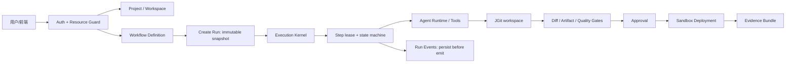

# AgentHub 架构说明

> 本文是当前架构的事实摘要，不承担长期路线、API 全量契约或技术答辩材料职责。长期路线见 [产品化长期计划](AGENTHUB_PRODUCT_LONG_TERM_PLAN.md)，接口细节见 [API 契约](API.md)，边界和证据见 [当前能力边界](CURRENT_CAPABILITY_BOUNDARIES.md)。

## 1. 架构定位

AgentHub 当前采用 Java 17 + Spring Boot 3.3.4 的模块化单体。所有核心业务共享一个事务数据库和一个应用进程；只有在真实负载或隔离需求触发后，才考虑把执行 Worker、沙箱或事件广播拆出。

模块按业务内聚性组织：

| 模块 | 责任 | 主要事实 |
| --- | --- | --- |
| `identity` | 登录、令牌、资源授权（`ResourceOwnershipVerifier`）、认证审计 | User、Token、AuthAudit |
| `project` | Project、Workspace、单一 `/api/workspaces/{workspaceId}` 资源族和项目归属 | Project、Workspace |
| `orchestration` | Workflow DSL、拓扑校验、审批门禁 | WorkflowDefinition、Approval |
| `execution` | Run/Step 状态、租约、恢复、事件流与证据包（内部拆分为 `RunCommandModule`、`RunQueryModule`、`RunEventStreamModule`、`RunEvidenceModule`） | WorkflowRun、StepRun、RunEvent |
| `agent` / `runtime` | Agent 注册、Provider 路由、Runtime SPI、用量和脱敏 | AgentDefinition、Provider、TokenUsage |
| `audit` | Artifact、JGit 结构化 Diff、审查和回滚 | Artifact、Evidence |
| `sandbox` | 受控构建、启动、探针、停止和清理 | Deployment |
| `ops` | 系统健康、API v1 契约元数据、OpenAPI 快照、旧接口迁移遥测、指标与冷备恢复 | SystemHealth、ApiContract、BackupManifest |
| `team` / `conversation` | 多 Agent 协作和消息上下文（隔离协作扩展） | Team、Conversation、Message |
| `infrastructure` | JGit、跨实例锁、指标和通用技术组件 | 共享技术能力 |

Controller 只负责协议转换和权限入口；Application 模块编排用例；Domain 模块承载状态和规则；Infrastructure 模块实现数据库、文件、Provider、进程和外部系统适配。Controller 不得直接注入 Repository、不得暴露 JPA Entity，也不得直接操作 `java.nio.file.Path`、`JGitWorkspaceManager` 或 `WorkspaceLockManager`（见 [ADR-006](adr/ADR-006-context-convergence-and-api-contract-v1.md)）。
`DagExecutionEngine` 对外保持单一执行入口，内部拆分为 `DagTopologyPlanner`、`DagLeaseExecutor`、`DagStateTransitioner`、`DagAgentInvoker`、`DagEventRecorder` 五个 seam。

## 2. 核心资源与事件词汇表 (Resource & Event Vocabulary)

发现代码与历史文档存在命名差异时，以实际持久化模型（Flyway V1～V12 + JPA Entity）与 REST/SSE 契约为唯一权威基准：

| 词汇概念 | Owner 模块 | 持久化表 / JPA Entity | 权威 API 入口 | 状态枚举 / 核心不变量 | 当前实现与演进说明 |
| --- | --- | --- | --- | --- | --- |
| `Project` | `project` | `projects` / `ProjectEntity` | `/api/projects` | `ACTIVE`, `ARCHIVED`；强制绑定 `owner_id` 与默认 `workspace_id` | 已落地；所有下属资源通过 `Project.ownerId` 校验归属 |
| `Workspace` | `project` | `workspaces` / `WorkspaceEntity` (+ `workspace_locks`) | `/api/workspaces/{workspaceId}/*` | 仅接受 `workspaceId` + 受检相对路径；JGit 维护 `git_baseline_commit` | 已落地；旧 `/api/workspace/*` 在 `prod` 已禁用，计划 Phase 1 删除 |
| `WorkflowDefinition` | `orchestration` | `workflow_definitions` / `WorkflowDefinitionEntity` | `/api/workflows/definitions` | Kahn 拓扑校验无环；含 `version`、`schema_version`、`dsl_json`、`checksum` | 已落地；Phase 3 将演进为绑定 `AgentDefinition` 快照的 `WorkflowTemplate` |
| `Run` (`WorkflowRun`) | `execution` | `workflow_runs` / `WorkflowRunEntity` | `/api/executions/runs`（别名 `/api/runs`） | `PENDING`, `RUNNING`, `PAUSED`, `WAITING_APPROVAL`, `SUCCEEDED`, `FAILED`, `CANCELLED`, `TIMED_OUT` | 已落地；创建时冻结 `dsl_snapshot`，支持 `idempotency_key` 与租约字段 |
| `StepRun` | `execution` | `step_runs` / `StepRunEntity` | `/api/executions/runs/{runId}/steps` | 状态同 `WorkflowRun` 外加 `SKIPPED`；含 `attempt`、`lease_owner`、`lease_until` | 已落地；重启恢复时已 `SUCCEEDED` 节点直接复用持久化输出，不重跑 |
| `Event` (`RunEvent` / `ToolCall`) | `execution` | `run_events` / `RunEventEntity` | `/api/executions/runs/{runId}/events` & `/stream` | 唯一约束 `uk_run_events_run_seq (run_id, sequence_num)`；含 `STEP_*`、`TOOL_CALL` 等事件，先落库后推送 SSE | 已落地；与 IM 会话的 `messages` 表物理隔离，分别服务于执行审计与协作 |
| `Artifact` | `audit` | `artifacts` / `ArtifactEntity` | `/api/audit/artifacts/*` | `review_status`: `PENDING`, `ACCEPTED`, `REJECTED`, `REVERTED`；含 SHA-256 `checksum` | 已落地；绑定 `run_id` 与 JGit 快照 commit，支持非破坏性文件级 `revert` |
| `Approval` | `orchestration` | `approvals` / `ApprovalEntity` | `/api/approvals/*` | `status`: `PENDING`, `APPROVED`, `REJECTED`；阻塞并唤醒 `WAITING_APPROVAL` 节点 | 已落地；审批决定写入 `decision_reason` / `comments` 并触发 DAG 续跑或终止 |
| `Deployment` | `sandbox` | `deployments` / `DeploymentEntity` | `/api/deployments` | `CREATED -> BUILD -> START -> HEALTH_CHECK -> RUNNING -> STOP -> CLEANUP -> STOPPED / FAILED` | 已落地；强制要求 `Artifact` 为 `ACCEPTED` 且通过真实 HTTP 探针才进入 `RUNNING` |
| `Agent Policy` (`AgentDefinition`) | `agent` / `sandbox` | `agent_definitions` + `providers` + `CommandSecurityGuard` | `/api/agents`, `/api/providers` | 包含 `preferred_provider_type`、`required_capabilities`、`fallback_enabled` 及工具/命令白名单 | 当前分散在 `AgentDefinitionEntity` 与沙箱守卫中；Phase 3 收敛为版本化策略模型 |
| `Context Source` | `execution` / `conversation` | `workflow_runs.context_data_json` + `conversations.summary` | `/api/conversations/{id}/context` | 包含 DAG 节点输入输出插值、滑动窗口裁剪（`TokenBudgetContextManager`）与滚动摘要 | 当前支持会话窗口与运行上下文；Phase 2/3 将扩展为带版本、安全级别与预算的受控资源 |

## 3. 核心数据流

Run 创建后冻结 DSL、输入、Provider/Runtime 策略、工作区基线、权限和预算快照。前端的 DAG、终端、审批、Diff 和预览都是这些持久化事实的投影。

## 4. 执行和事件语义

`DagExecutionEngine` 是生产执行内核。Run/Step 通过数据库条件更新和租约字段领取，`PersistentExecutionRecoveryRunner` 在应用启动或租约过期后恢复未完成工作。已成功的 Step 从持久化输出恢复，不能因 JVM 重启而重复产生副作用。

执行语义是 at-least-once 调度加幂等副作用：每次尝试有 attempt、租约、超时、取消和审计记录；系统不宣称分布式 exactly-once。状态迁移必须经过统一状态机，不能由多个线程直接改 Entity 字段。

RunEvent 先持久化，再推送给 SSE。客户端使用 `Last-Event-ID` 或游标补回断线期间的事件。当前活跃 SSE 连接、取消令牌和审批唤醒仍有单节点内存部分，多实例广播属于后续阶段能力。

## 5. 受控工作区、安全配额与生命周期运维

Workspace API 只接受服务端 `workspaceId` 与受检相对路径。`DefaultWorkspaceResolver` 与 `GitSourceConfig` 统一阻断绝对路径（盘符、`/etc` 等）、目录穿越、符号链接逃逸和受保护目录；JGit 保存基线、快照、结构化 Diff 和回滚记录。并发写入由数据库租约、JVM 锁和 OS 文件锁共同保护。

在 Phase 2 中，受控工作区实现了完整产品化生命周期与安全策略：
1. **7 步受控接入向导（Onboarding Wizard）**：不可跳过地依序执行代码源连接、凭据脱敏校验（严禁明文 Token）、默认分支选择、工作区分配与隔离分支、技术栈环境扫描、工程防御规约生成（`PROJECT_RULES.md`）、以及初始 Git 基线确权；支持步骤失败重试与中止回滚；
2. **工作区安全配额（`WorkspaceQuotaGuard`）**：严格实行单文件写入 10MB、文本预览 2MB、工作区总容量 500MB、文件总数 5000 个、执行超时 3600 秒以及网络访问控制策略，超配额统一触发 `BLOCKED_POLICY (3012)`；
3. **受控工作区生命周期运维**：提供 `resyncWorkspace`（重同步至基线）、`changeBaseline`（变更基线）、`discardWorkspace`（放弃未提交变更）、`restoreSnapshot`（恢复指定快照）、以及 `getWorkspaceQuota`（实时配额监视）；危险操作强制用户显式确认（`confirmed=true`）并由 `AuthAuditService` 记入审计日志。

## 6. Agent 工作单元、工作流模板与 Orchestrator 计划 (Phase 3 产品化事实)

Provider 通过 `LlmProvider` SPI 接入，路由按能力、优先级、成本、健康度和熔断状态选择。在 Phase 3 中，系统实现了 Agent 治理、工作流模板与计划门禁的全面产品化：

1. **版本化 `AgentDefinition` 与内置规范角色**：
   - 固化 `AgentDefinitionManifest`（工具白名单、参数 JSON Schema、ProviderPolicy、AgentBudget 预算上限、安全级别与停止条件）；
   - 系统启动确权 4 大规范研发角色：`backend-architect`、`backend-developer`、`qa-tester`、`security-reviewer`。
2. **7 大内置 Agent 工具体系与防爆配额**：
   - 固化 `file_read`、`file_write`、`command_exec`、`code_search`、`git_operations`、`test_runner`、`context_inspect` 规范与参数 Schema；
   - `guardOutputSize` 为工具输出提供最大 512KB～2MB 的字节配额保护，超限自动安全截断并记录标记。
3. **Kahn DAG 校验与并行批次编排**：
   - `WorkflowDslValidator` 严格执行自环、环路与孤岛节点多重拓扑防御；
   - 计算阶段级并行执行批次（`executionStages`），并强制审批意图节点标注 `requiresApproval=true`。
4. **版本化 `WorkflowTemplate` 矩阵**：
   - 预置 `BUG_FIX_WITH_TESTS`（7 阶段含审批门禁）与 `NEW_FEATURE_ENDPOINT`（7 阶段 DDD 端点交付）两大核心工业级模板；
   - 支持动态实例化生成带时间戳与版本的 `WorkflowDefinition`。
5. **Orchestrator 计划生成与高影响工具门禁**：
   - 执行前生成结构化 `OrchestrationPlan`（预测受影响文件、子任务拆解、预算配额、质量门禁、工具权限清单）；
   - `enforceHighImpactToolAuthorization` 双重门禁：未经用户确认前阻断 `file_write` / `command_exec` 等高影响写操作与执行命令（`4003 FORBIDDEN`）；用户审查确认后方放行执行。
6. **6 层上下文分层组装引擎（`ContextAssemblyEngine`）**：
   - 依序组装：`SYSTEM_AND_PROJECT_RULES` -> `AOCI_COGNITION` -> `AFFECTED_FILES` -> `CONVERSATION_HISTORY` -> `TOOL_RESULTS` -> `USER_INPUT`；
   - 每层独立分配 Token 预算、截断策略与安全级别标记。
7. **真实活体 Provider 路由保护（`requireLive`）**：
   - `ChatRequest.requireLive=true` 严禁静默回退至 Mock；无活跃可用真实 Provider 时显式抛出 `NoAvailableProviderException`。
8. **离线自动化评测基准（`OfflineEvaluationApplication`）**：
   - 内置覆盖 5 大典型任务的 Benchmark 套件（新端点、缺陷修复、重构、测试补齐、对抗注入防御），量化通过率、工具误用率与 Diff 采纳率。

### 7. Run Operations、统一状态图与长上下文可靠性 (Phase 4 架构事实)

在 Phase 4 中，系统将运行运维、人工决策与长上下文可靠性收敛为单一产品对象：

1. **单一统一状态图（`UnifiedExecutionStateGraph`）**：
   - 穷举 `WorkflowRunStatus`（8 种状态）与 `StepRunStatus`（6 种状态）的合法跃迁矩阵，终态严禁跃迁回运行态（非法流转抛出 `IllegalStateException`）；
   - 提供跨实体一致性校验（`isRunStepConsistent`）与结构化下一步调度决策（`determineNextAction`），输出操作员待办决策清单（`PendingDecisionItem`）。
2. **At-Least-Once 语义与三级异常归因（`ExecutionErrorClassifier`）**：
   - 细分为 `RETRYABLE_TRANSIENT`（网络超时、429、连接重置触发自动指数退避）、`APPROVAL_REQUIRED`（高影响工具越权、预算超限转人工确认）与 `FATAL_NON_RETRYABLE`（业务异常、空指针、DSL 语法损坏立即阻断）；
   - `startRun` 基于 `idempotencyKey` 防重入，重复触发返回已有运行实例。
3. **事务性发件箱（Transactional Outbox）**：
   - `RunEventBroadcaster` 采用 Spring 事务同步机制（`afterCommit`），仅在数据库事务提交后向 SSE 派发实时事件，消除事务回滚幻象事件；
   - 严格单调递增 `sequenceNum` 支持客户端通过 `Last-Event-ID` 增量重放。
4. **三层拓扑分层上下文记忆与不变量保留压缩**：
   - `HierarchicalContextMemory` 划分为 Tier 1 (ProjectMemory)、Tier 2 (RunMemory) 与 Tier 3 (StepMemoryItem)；
   - `ContextMemoryCompressor` 超预算时压缩历史成功日志，绝对保留核心规约、文件改动收据、审批决定与错误堆栈；
   - `verifyCognitionAndReceipt` 结合 JGit 真实校验工作区未提交文件漂移状态。
5. **产物全生命周期血缘图谱与非破坏性 JGit 审查回滚**：
   - 提供 `GET /api/audit/artifacts/lineage/{runId}` 贯穿 `Run -> StepRun -> Artifact -> Commit Hash -> Checksums -> Approvals`；
   - 提供 `GET /api/audit/artifacts/{artifactId}/diff` 计算结构化行级 Diff；
   - 提供 `POST /api/audit/artifacts/{artifactId}/revert` 仅还原该产物涉及的文件，保留工作区中用户独立创建的文件，杜绝毁灭性 `git reset --hard`。
6. **运行运维控制台端点与前端落地**：
   - 后端统一端点 `GET /api/executions/runs/{runId}/operations`（`RunOperationsView`）；
   - 前端集成 `RunOperationsPanel.tsx`（Bento Grid 运维面板）与 `StructuredDiffReviewModal.tsx`（代码审查与无损回滚模态框）。

## 8. 质量门禁、代码审查与受控交付产品化 (Phase 5 架构事实)

在 Phase 5 中，系统将自动化质量防御、细粒度人工干预与受控交付流程全面产品化（见 [`ADR-010`](adr/ADR-010-quality-gates-review-and-controlled-delivery.md)）：

1. **质量门禁策略引擎（`QualityGateEngine`）**：
   - 固化 5 大核心防御维度：`BUILD_VERIFICATION`（构建一票否决）、`UNIT_TEST_REGRESSION`（100% 绿灯回归）、`STATIC_ANALYSIS_GUARD`（架构分层与命名规范）、`SECRET_LEAK_SCAN`（API Key/私钥/Token 敏感泄漏扫描）与 `DIFF_BUDGET_GUARD`（代码变更规模预算）；
   - 输出结构化 `QualityGateReport` 与 `QualityGateCheckItem` 明细，计算加权综合评分（0～100 分），生成不可伪造的 SHA-256 签名指纹；
   - 门禁未通过的产物严格标记为 `GATE_FAILED`，任何未过门禁产物坚决阻断后续预览与交付。
2. **细粒度人工干预：步骤重做（Rework）与全盘驳回（Reject）**：
   - **`reworkStep`**：支持评审人在任意步骤提供指导意见（`feedback`），系统将 `StepRun` 重置为 `PENDING`，自增 `attempt` 并将意见注入步骤上下文，记录 `STEP_REWORK_REQUESTED` 审计事件后重新唤醒调度器；
   - **`rejectRun`**：支持全盘驳回运行，将受控工作区严格安全回滚至 Baseline Commit，终止所有未完成 Step，将 WorkflowRun 状态收敛为 `REJECTED` 并记录 `RUN_REJECTED` 事件。
3. **JGit 单文件非破坏性精准回滚（`revertSingleFile`）**：
   - `JGitWorkspaceManager` 结合底层 Git Checkout 精准将特定相对路径的文件还原至基线 Commit（新增文件彻底物理安全删除），工作区内其他文件修改完全保持完好；
   - 生成原子回滚 Commit 并记录 `FILE_REVERTED` 审计条目，避免全局回滚带来的误伤。
4. **受控沙箱准入门禁与主动探针**：
   - `DeploymentApplicationService` 严格执行准入检查：拦截关联产物处于 `GATE_FAILED` 或 `REJECTED` 的部署请求（抛出 `400 PARAM_ERROR`）；
   - 提供 `probeDeployment` 主动 HTTP 健康探针，对目标预览环境发起探测并测量往返延迟（ms），更新探针审计时间戳。
5. **外部标准化交付物：PR 草稿规范与全量脱机证据包**：
   - 提供 `PullRequestDraftView` 生成符合 GitHub/GitLab 规范的结构化 PR 草稿，包含 Markdown 动机正文、门禁得分徽章与受影响文件列表；
   - 提供 `exportRunEvidenceBundle` 导出包含完整状态、JGit 逐行 Diff、门禁评分指纹、脱敏审计流与 SHA-256 Checksum 的确定性证据包。

## 9. 团队协作、组织角色与长期运维体系 (Phase 6 架构事实)

在 Phase 6 中，系统将细粒度组织权限隔离、不可篡改安全审计流水、长期运维指标与灾备还原全面产品化（见 [`ADR-011`](adr/ADR-011-team-collaboration-rbac-and-operations-productization.md)）：

1. **细粒度项目级 RBAC 权限矩阵（`ProjectRbacRole` & `ProjectPermission`）**：
   - 确权 6 级核心研发角色：`OWNER`（项目所有者）、`ADMIN`（项目管理员）、`MAINTAINER`（核心维护者）、`DEVELOPER`（日常研发）、`VIEWER`（只读观察员）、`AUDITOR`（合规审计员）；
   - `ResourceOwnershipVerifier` 实现细粒度防越权守卫方法（`verifyWorkspaceWriteAccess`、`verifyRunExecuteAccess`、`verifyApprovalAccess`、`verifyDeploymentAccess` 等），无破坏性映射复用既有 `teams` 与 `team_members` 实体关系表；
   - 提供团队成员生命周期管理端点：`getCurrentUserRole`、`listProjectMembers`、`addProjectMember`、`updateMemberRole`、`removeProjectMember`，并对唯一 OWNER 施加防误删防降级保护。
2. **不可篡改安全审计流水（Immutable Security Audit Logs）**：
   - 基于 `auth_audit_logs` 表记录完整安全事件：`eventId`、`userId`、`eventType`、`ipAddress`、`detailsJson`、`createdAt`；
   - 核心事件只增不减（Append-Only），`GET /api/system/audit-logs` 提供分页与按用户/事件类型的多维结构化审计查询。
3. **确定性灾备快照与幂等还原体系（Disaster Recovery Snapshot & Idempotent Restore）**：
   - `POST /api/system/backup`：生成包含全量表元数据统计、SHA-256 Checksum 与快照清单的 `BackupManifest`；
   - `POST /api/system/backup/verify`：对快照完整性与防篡改指纹进行真实二次校验并生成 `RestoreVerificationReport`；
   - `POST /api/system/backup/restore`：执行确定性幂等还原与数据一致性基线重构，完整记录灾备还原事件并自愈运维状态。
4. **运行时运维指标大盘与 SLO 健康度评测（Ops Metrics & SLO Evaluation）**：
   - `GET /api/system/metrics/summary` 统一聚合工作流执行吞吐量、失败率、P95/P99 延迟、活动部署数、工作区磁盘容量、JVM 堆内存与 GC 状态，并联动 Prometheus 告警规则；
   - `AgentHubMetricsCollector` 根据执行成功率与关键性能指标自动评测输出系统级 SLO 健康度评级（`HEALTHY` / `DEGRADED` / `UNHEALTHY`）。
5. **前端团队协作与运维灾备控制台（TeamRbacPanel & OperationsConsolePanel）**：
   - Bento Grid 现代美学风格的成员协作卡片、角色授权弹窗、SLO 健康指示灯、灾备快照触发/验证/还原表单与可分页审计日志列表，深度融合于 `ProjectShell` 核心交付大盘。

## 10. 数据库表全景矩阵与可观测性 (Flyway V1～V12 共 22 张表)

- Flyway 是唯一 Schema 演进方式；生产使用 `ddl-auto=validate`。
- Micrometer/Prometheus 暴露 Run、Step、Provider、SSE、锁和 Deployment 指标；日志必须结构化并脱敏。
- 证据包使用脱敏内容、模式标识和确定性 checksum；证据包只能证明对应 Run 的事实，不能替代目标环境验证。

| 数据库表名 | Owner 模块 | JPA Entity / 访问组件 | 来源迁移 | 认证与归属隔离 | 幂等 / 唯一约束 | 状态 | 核心验证测试 | 删除 / 演进计划 |
| --- | --- | --- | --- | --- | --- | --- | --- | --- |
| `users` | `identity` | `UserEntity` | `V1`, `V2` | 自身为主体 (`id`) | `PRIMARY KEY(id)`, `UNIQUE(email)` | `ACTIVE` | `RestApiSecurityAndMultiTenancyIntegrationTest` | 长期保留；`V2` 演示种子在 Phase 1 迁入 demo profile |
| `invalidated_tokens` | `identity` | `InvalidatedTokenEntity` | `V9` | `user_id` 关联当前用户 | `PRIMARY KEY(token_id)` | `ACTIVE` | `PhaseASecurityAndResourceBoundaryIntegrationTest` | 长期保留；过期记录按 `expires_at` 清理 |
| `auth_audit_logs` | `identity` | `AuthAuditLogEntity` | `V9` | 记录 `user_id`、`email`、`ip_address` | `PRIMARY KEY(id)` | `ACTIVE` | `PhaseASecurityAndResourceBoundaryIntegrationTest` | 长期保留；只追加审计表 |
| `projects` | `project` | `ProjectEntity` | `V1`, `V2` | `owner_id` (`ResourceAccessGuard`) | `PRIMARY KEY(id)` | `ACTIVE` | `PhaseASecurityAndResourceBoundaryIntegrationTest` | 长期保留；`proj-default` 种子在 Phase 1 迁入 demo profile |
| `workspaces` | `project` | `WorkspaceEntity` | `V1`, `V2` | 经 `project_id -> projects.owner_id` 校验 | `PRIMARY KEY(id)` | `ACTIVE` | `WorkspaceSecurityAndJGitAuditIntegrationTest` | 长期保留；`ws-default` 种子在 Phase 1 迁入 demo profile |
| `workspace_locks` | `infrastructure` | `WorkspaceLockManager` (JDBC) | `V3`, `V12` | `owner_id` 服务端从认证上下文派生 | `PRIMARY KEY(workspace_key)` + `expires_at_epoch_ms` 条件更新 | `ACTIVE` | `PhaseEProductionOpsAndDisasterRecoveryIntegrationTest` | 长期保留；跨实例毫秒级租约互斥 |
| `agent_definitions` | `agent` | `AgentDefinitionEntity` | `V1`, `V2`, `V6` | 系统级模板，调用需登录 | `PRIMARY KEY(id)`, `UNIQUE(def_key)` | `ACTIVE` | `ProviderDrivenAgentRuntimeIntegrationTest` | Phase 3 演进为带工具权限、上下文来源与预算的版本化定义 |
| `agent_instances` | `agent` | `AgentInstanceEntity` | `V1` | `owner_id` + `project_id` | `PRIMARY KEY(id)` | `ACTIVE` | `FlywayMigrationAndSchemaTest` | Phase 3 与版本化 `AgentDefinition` 快照合并收敛 |
| `providers` | `agent` | `ProviderEntity` | `V1`, `V6` | `owner_id` (`ResourceAccessGuard`) | `PRIMARY KEY(id)` | `ACTIVE` | `ProviderAndTokenUsageControllerIntegrationTest` | 长期保留；`secret_ref` 脱敏存储，`V6` 默认种子 Phase 1 隔离 |
| `token_usages` | `agent` | `TokenUsageAuditEntity` | `V6` | 经 `run_id -> workflow_runs` 校验 | `PRIMARY KEY(id)` | `ACTIVE` | `TokenCostAccountingAndAuditingTest` | 长期保留；区分真实 Provider 计费与 `DEMO_SIMULATED` |
| `teams` | `team` | `TeamEntity` | `V1`, `V7` | 经 `project_id` 校验归属 | `PRIMARY KEY(id)` | `ACTIVE` | `Phase6TeamRbacAndOperationsTest`, `TeamAndConversationControllerIntegrationTest` | Phase 6 升级为细粒度团队协作与 RBAC 关系基础 |
| `team_members` | `team` | `TeamMemberEntity` | `V1`, `V7` | 经 `team_id -> teams` 校验 | `PRIMARY KEY(id)` | `ACTIVE` | `Phase6TeamRbacAndOperationsTest`, `TeamTopologyAndCoordinationTest` | Phase 6 承载项目成员角色映射 |
| `conversations` | `conversation` | `ConversationEntity` | `V1`, `V7` | `owner_id` + `project_id` 校验 | `PRIMARY KEY(id)` | `ISOLATED_EXT` | `ConversationEntityRelationAndMessageSchemaTest` | Phase 1 移除 Entity 默认 `user-1`/`proj-default` 赋值 |
| `conversation_participants` | `conversation` | `ConversationParticipantEntity` | `V1` | 经 `conversation_id` 校验 | `PRIMARY KEY(id)` | `ISOLATED_EXT` | `MessageRoutingAndVisibilityIsolationTest` | 作为协作扩展隔离维护 |
| `messages` | `conversation` | `MessageEntity` | `V1`, `V7` | 经 `conversation_id` + `MessageVisibilityFilter` | `PRIMARY KEY(id)`, `(conversation_id, sequence_num)` 单调递增 | `ISOLATED_EXT` | `ConversationMonotonicSequenceAndConcurrencyTest` | 作为协作扩展隔离维护 |
| `workflow_definitions` | `orchestration` | `WorkflowDefinitionEntity` | `V1`, `V5`, `V10` | 登录鉴权 + 项目关联校验 | `PRIMARY KEY(id)` + `checksum` | `ACTIVE` | `WorkflowDefinitionAndApprovalControllerIntegrationTest` | 长期保留；Phase 3 升级为 `WorkflowTemplate` |
| `workflow_runs` | `execution` | `WorkflowRunEntity` | `V1`, `V4`, `V5`, `V10` | 经 `project_id -> projects.owner_id` 校验 | `PRIMARY KEY(id)` + `idempotency_key` 防重 + `lease_until` 抢占 | `ACTIVE` | `PersistentExecutionRecoveryAndLeaseTest` | 长期保留；执行事实唯一权威来源 |
| `step_runs` | `execution` | `StepRunEntity` | `V1`, `V4`, `V5`, `V10` | 经 `run_id -> workflow_runs` 校验 | `PRIMARY KEY(id)` + `(run_id, node_id)` + `attempt` | `ACTIVE` | `PersistentExecutionRecoveryAndLeaseTest` | 长期保留；节点级状态机与租约载体 |
| `run_events` | `execution` | `RunEventEntity` | `V1`, `V10` | 经 `run_id -> workflow_runs` 校验 | `PRIMARY KEY(id)`, `UNIQUE uk_run_events_run_seq(run_id, sequence_num)` | `ACTIVE` | `ExecutionSseStreamAndReconnectionTest` | 长期保留；SSE 断点续传与证据包事件源 |
| `artifacts` | `audit` | `ArtifactEntity` | `V1`, `V3` | 经 `run_id -> workflow_runs` 校验 | `PRIMARY KEY(id)` + SHA-256 `checksum` | `ACTIVE` | `WorkspaceSecurityAndJGitAuditIntegrationTest`, `Phase4RunOperationsAndArtifactLineageTest` | 长期保留；Phase 4 落地 Artifact Lineage 与 JGit 结构化 Diff 审查 |
| `approvals` | `orchestration` | `ApprovalEntity` | `V1`, `V5` | 经 `run_id -> workflow_runs` 校验 | `PRIMARY KEY(id)`；单次决策状态转换 | `ACTIVE` | `HumanInTheLoopApprovalIntegrationTest` | 长期保留；人工审批门禁权威记录 |
| `deployments` | `sandbox` | `DeploymentEntity` | `V1`, `V8`, `V11` | 经 `project_id -> projects.owner_id` 校验 | `PRIMARY KEY(id)` + 受控端口池原子分配 | `ACTIVE` | `PhaseDSandboxLifecycleAndDeliveryIntegrationTest` | 长期保留；绑定已验收 `artifact_id` 与健康探针轨迹 |

## 10. 真实 Provider 矩阵、模式强隔离与成本预算治理 (Phase 7 产品化事实)

1. **主流模型客户端与统一工具调用（Tool Calling）**：
   - 固化 `OpenAiCompatibleProvider`（OpenAI 与 DeepSeek）、`AnthropicProvider` 与 `GeminiProvider` 适配层；
   - 统一 Function Calling 请求结构注入与 `ToolCall` 领域实体提取，支持流式 SSE 增量 delta 片段解析；
   - 内置指数退避重试算法（Exponential Backoff with Jitter），针对 429 与 5xx 瞬时网络抖动自动补偿。
2. **运行模式强隔离 (Strict Mode Segregation)**：
   - `DEMO_SIMULATED`：本地脱机演示与单元测试，允许透明路由到 `MockLlmProvider`；
   - `LIVE_SELF_HOSTED` 与 `LIVE_TEAM`：生产自托管与企业团队模式，严格拒绝静默降级为 Mock，无可用节点时立即抛出 `NoAvailableProviderException (5009)`。
3. **模型权威定价与 Prompt Cache 计费字典 (`ModelPricing`)**：
   - 登记主流厂商标准输入/输出百万 Token 牌价字典；
   - 支持 Prompt Cache 命中折扣计费核算（`calculateCostWithCache`）。
4. **调用前硬预算看门狗拦截 (`BudgetGovernanceGuard`)**：
   - 挂载于 `ProviderDrivenAgentRuntime` 与 `DagAgentInvoker` 前置切面；
   - 生产硬限额默认 $50.00，80% 预警水位，超限立即抛出 `BUDGET_EXCEEDED (5010)` 阻断执行。
5. **主动探针与熔断器动态运维**：
   - 提供 `POST /api/providers/{id}/probe` 主动测量物理往返延迟（ms）；
   - 提供 `GET & POST /api/providers/{id}/circuit-breaker` 查询与人工重置熔断器（`CLOSED`）。

## 11. 端到端验收、性能基准与开源/交付就绪事实 (Phase 8 产品化事实)

1. **10 阶段全流程自动化闭环验证**：
   - 固化覆盖 Project Onboarding、Workspace JGit Baseline、WorkflowTemplate 拓扑解析、Orchestrator 计划生成与确认、Agent 运行时状态流转、质量门禁多维评估、Pull Request 草稿生成、受控预览部署与主动探针、审计流水与血缘追踪、脱敏运行证据包导出的全生命周期集成测试。
2. **性能基准指标与防衰退断言**：
   - 确立 12 线程并发工作流状态推进压测基准，断言 P95 延迟受控（< 5000ms）；
   - 确立 SSE 事件广播物理延迟受控（< 100ms），并通过 `Last-Event-ID` 保证断线重连单调递增回放；
   - 确立高负载内存稳定性基准，断言有效堆内存增量在受控边界内（< 100MB），杜绝静态对象泄漏。
3. **Webhook 事件契约与安全签名规约**：
   - 固化 22 种覆盖核心生命周期的标准事件类型（`WebhookEventType`）；
   - 提供基于 HMAC-SHA256 的防篡改签名规约（`X-AgentHub-Signature`）与时间戳防重放容差校验（`WebhookSignatureVerifier`）。
4. **稳定发行清单与最小 SDK / 扩展 SPI 契约**：
   - 固化 `1.0.0-RELEASE` 发行清单（`AgentHubReleaseManifest`）；
   - 规范 Project、Run、Artifact、Approval、Deployment 5 大核心 SDK 客户端契约；
   - 规范 Provider、Tool、AgentDefinition、WorkflowTemplate、DeploymentTemplate 5 大扩展 SPI 契约，经 `GET /api/system/contracts/v1` 统一暴露。
5. **质量门禁准入防御**：
   - 部署服务严格拦截未通过质量门禁（`GATE_FAILED`）或人工拒绝（`REJECTED`）的制品，保障受控发布。

## 12. 架构守卫和扩展规则

ArchUnit（`ArchUnitArchitectureTest`）与 Phase 0 基线守卫（`Phase0BaselineAndDebtFreezeGuardTest`）联合守护分层依赖、Controller 位置、Entity 泄露、废弃组件零新增调用、前端零 `localhost:8080` 直连及默认 ID 冻结。新增 Provider、节点类型、工具或部署模板必须同时提供真实用户旅程、权限模型、成本边界、契约测试、可观测字段和删除条件。没有真实使用者的适配器进入瘦身清单，不继续堆叠。

详细取舍保存在 [ADR-001](adr/ADR-001-modular-monolith-architecture.md) 至 [ADR-013](adr/ADR-013-e2e-benchmarks-and-release-readiness.md)。

